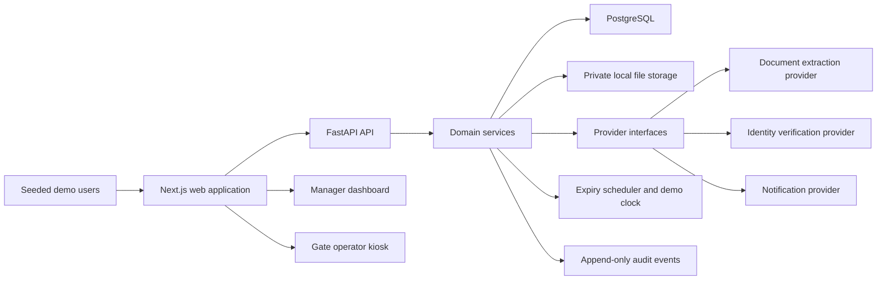
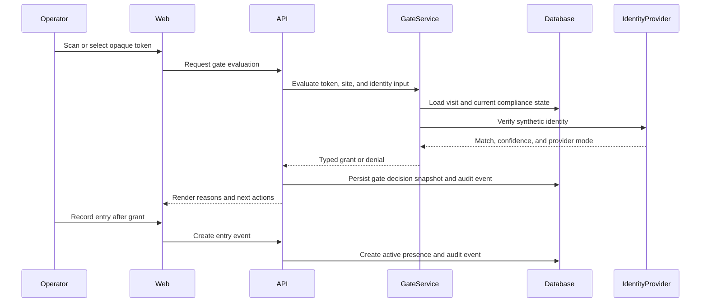

# Renewi Contractor and Visitor Site Access Demo Architecture

## Status and Authority

This document records the proposed architecture for a greenfield manager-facing demo. At STEP-01 completion, no application containers, schemas, services, or interfaces described here have been implemented.

The business context, populations, compliance themes, and proposed eleven-step journey come from the supplied DigitalT3 material. The technology stack, service boundaries, provider ports, persistence rules, and deployment shape are **DEMO DESIGN** decisions. They are not assertions about Renewi's current production systems.

## Architectural Objectives

The architecture must make one connected lifecycle demonstrable: invitation, pre-registration, evidence, training, approval, token issue, gate arrival, grant or denial, presence, dashboard reporting, and expiry or re-validation.

The complete application must run without external credentials. The API domain layer must be authoritative for business transitions and gate decisions. The system must preserve auditability, use only synthetic data, keep uploads private, and avoid raw personal information in QR payloads.

## Logical System Map



The browser communicates with the API and does not connect directly to PostgreSQL, private storage, or optional providers. Provider SDKs remain behind API interfaces.

## Proposed Repository Boundaries

| Area | Planned location | Responsibility |
| --- | --- | --- |
| Web | `apps/web/` | Next.js routes, role-aware shell, workflow forms, person timeline, evidence review, gate kiosk, roster, dashboard, and re-validation interfaces |
| API | `services/api/` | FastAPI routes, typed contracts, domain services, authorization, persistence, provider adapters, scheduling, seed, reset, and health |
| Migrations | `database/migrations/` | Alembic revisions executed by the API environment |
| Private demo storage | `storage/demo/` or a mounted equivalent | Synthetic uploads and generated assets outside the web public directory |
| Browser tests | `tests/e2e/` | Playwright fixtures, lifecycle tests, role checks, denials, expiry, and reset |
| Requirements | `requirements/` | Source-versus-demo contract, environment, data, integrations, acceptance, and open questions |
| Operator documentation | `docs/` | Architecture and final manager demonstration guidance |
| Local orchestration | `docker-compose.yml` | Web, API, PostgreSQL, optional E2E service, health checks, and named volumes |

These are committed implementation targets from the approved plan. They become current-state descriptions only after the corresponding files exist.

## Container Responsibilities

### Web Application

The web application renders typed API state, manages accessible interaction and client cache invalidation, and presents role-aware navigation. TanStack Query owns remote client state. React Hook Form and Zod own form interaction and client-side validation.

The web application may mirror permissions for display but may not authorize a request. It may render compliance checks and gate outcomes but may not independently calculate whether access is granted.

### API

FastAPI exposes authentication, people, companies, visits, invitations, evidence, training, approvals, blacklist, access tokens, gate evaluation, gate events, presence, dashboard, re-validation, audit, and demo-control contracts.

Domain services own business transitions. API authorization dependencies enforce the seeded role model. Pydantic schemas define request and response contracts, while SQLAlchemy units of work control transaction boundaries.

### PostgreSQL

PostgreSQL is the authoritative source for durable application state. Time values are stored with timezone information in UTC. Site timezone determines visit-window interpretation and per-day dashboard boundaries.

State changes that produce an audit event must persist the domain result and audit event in the same transaction whenever practical.

### Private Storage

Synthetic evidence is stored behind `StorageProvider`. Storage references are opaque to the browser. Validation of file size, extension, MIME type, and access permission occurs before retrieval or persistence.

## Domain Service Boundaries

| Service | Primary responsibility |
| --- | --- |
| `EvidenceService` | Upload metadata, private storage, extraction, reviewer edits, verification, rejection, and re-upload requests |
| `TrainingService` | Modules, questions, attempts, scores, pass or fail, completion, validity, and expiry |
| `ComplianceService` | Resolve configured site and population requirements into typed checks |
| `ApprovalService` | Evaluate eligibility and record approve, reject, or correction-request decisions |
| `TokenService` | Issue, resolve, expire, and revoke opaque visit-bound access tokens |
| `GateService` | Orchestrate token, standing, blacklist, evidence, training, approval, and identity checks |
| `PresenceService` | Create one active on-site record after grant and close it on exit |
| `DashboardService` | Derive site-and-day metrics from persisted visits, decisions, presence, approvals, and expiry |
| `RevalidationService` | Detect expiry bands, create unique tasks, process renewal, and restore eligibility |
| `DemoClockService` | Persist and apply a reversible demonstration time offset |
| `AuditService` | Append actor, action, entity, reason, details, and time for material business events |

Route handlers must coordinate authentication, validation, and service invocation without embedding domain rules.

## Core Data Ownership

The relational model includes `Person`, `Company`, `Site`, `Visit`, `Invitation`, `Evidence`, `TrainingModule`, `TrainingResult`, `Approval`, `BlacklistEntry`, `ComplianceRequirement`, `AccessToken`, `GateEvent`, `OnSiteRecord`, `RevalidationTask`, `AuditEvent`, `DemoScenario`, `DemoClock`, and role-account records.

Person standing is separate from visit workflow state. One person may have several visits without losing earlier history. Person-level or company-level blacklist entries continue to affect all applicable visits.

Normal workflows do not physically delete evidence, approvals, tokens, gate events, presence history, re-validation history, or audit events. They change status, create a replacement, revoke access, or close an active interval.

## Provider Interfaces

The API composes four provider ports:

| Port | Default implementation | Optional implementation |
| --- | --- | --- |
| `DocumentExtractionProvider` | `MockDocumentParser` | `AnthropicVisionDocumentParser` |
| `IdentityVerificationProvider` | `MockIdentityVerifier` | Future CV provider adapter |
| `StorageProvider` | `LocalStorage` | `S3Storage` |
| `NotificationProvider` | `InAppNotification` | `SmtpNotification` |

Missing optional credentials select the local implementation. The selected provider mode is returned to the UI and audit layer in sanitized form. Full behavior is defined in `requirements/INTEGRATIONS.md`.

## Gate Decision Contract

`GateService.evaluate` accepts an opaque token reference, site reference, operator reference, and identity-provider input. It evaluates the following precedence:

1. Token existence, status, site, and visit window.
2. Person standing and revocation state.
3. Active person or company blacklist.
4. Mandatory evidence presence, verification, and validity.
5. Mandatory training completion and validity.
6. Current approval eligibility.
7. Identity match.
8. Final grant or denial.

The response contains the final decision, typed checks, reason codes, readable reasons, corrective actions, identity confidence, provider mode, and evaluation time. A representative response shape is:

```json
{
  "decision": "DENY",
  "checks": [
    {
      "code": "VCA",
      "status": "EXPIRED",
      "blocking": true
    }
  ],
  "reason_codes": [
    "VCA_EXPIRED"
  ],
  "reasons": [
    "Access denied because the VCA certificate has expired."
  ],
  "next_actions": [
    "Renew and verify the VCA evidence."
  ],
  "identity_confidence": 0.96,
  "provider_mode": "DEMO",
  "evaluated_at": "timezone-aware timestamp"
}
```

An evaluation does not create presence automatically. A separate authorized gate-event command records denial or records entry after an explicit operator action.

## Gate and Presence Flow



The database snapshot of a gate decision preserves the checks and reasons that applied at evaluation time. Later rule changes must not rewrite historical decisions.

## Compliance Configuration

Compliance rules are records keyed by site, population applicability, requirement code, related evidence or training, required flag, blocking severity, verification method, validity, and renewal lead time.

The UI may group and explain these records but must not hard-code driver, contractor, or visitor eligibility. Blacklist is always blocking in the demo.

## Authentication and Authorization

The proposed demo uses locally signed, short-lived sessions in `HttpOnly`, `SameSite=Lax` cookies. Seeded users authenticate without an external identity provider.

API dependencies enforce role permissions for every mutation and sensitive read. Frontend navigation reflects permissions for usability but is not a security boundary. Demo controls, time advancement, and scenario reset are restricted to System Admin.

## Token and QR Safety

An access token belongs to a visit and includes site and validity semantics in server-side records. The QR payload contains only a non-guessable opaque reference. The API stores a hash suitable for lookup or verification and does not place a person's name, email, company, evidence, or visit details in the QR payload.

Revocation and expiry do not erase the token history. Gate evaluation resolves current token state and re-evaluates current compliance before granting access.

## Expiry and Scheduling

A persisted demo-clock offset advances effective application time without changing the host clock. APScheduler runs expiry scanning inside the single demo API worker, and an admin-only endpoint supports manual execution.

Expiry processing covers evidence, training, approvals, and tokens. It uses 30-day, 14-day, 7-day, and expired bands and creates or updates re-validation tasks through an idempotent key. Repeated scans must not create duplicate active tasks.

## Auditability

Important business commands append audit events containing actor, action, entity, reason, details, and occurrence time. Required events cover invitation, registration, evidence, training, approval, blacklist, token, gate, presence, expiry, and re-validation.

Audit events are append-only during normal operation. Scenario and full-demo resets may recreate the deterministic database state, but ordinary user actions must not remove historical evidence.

## Client State and Refresh

Successful web mutations invalidate the affected person, visit, evidence, training, approval, token, audit, roster, dashboard, and re-validation query keys. The dashboard never uses hard-coded metrics; values come from API aggregates over persisted state.

## Security and Privacy Boundary

The repository contains synthetic data only. Simulated identity matching does not process real biometric data. Uploads remain private and constrained. Secrets stay in runtime configuration. Ordinary users never receive stack traces, provider secrets, storage paths, or database details.

The architecture does not claim production legal compliance, DPIA completion, production retention, enterprise accreditation, offline gate safety, or physical-barrier integration. Those decisions remain in `requirements/OPEN_QUESTIONS.md`.

## Initial Architecture Validation

STEP-01 validation confirms that the credential, environment, demo-data, and integration contracts all name deterministic local behavior. Later validation must prove that the implementation follows these boundaries, especially server-owned gate decisions, API authorization, private uploads, opaque QR payloads, idempotent expiry, and no-credential execution.
