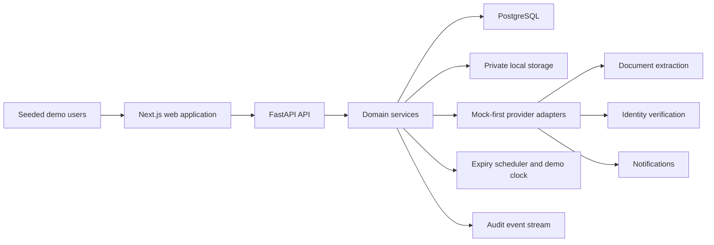

[CodeWiki](../../index.md) / [Artifacts](../index.md) / [Implementation Plans](index.md)

# Renewi Contractor and Visitor Site Access Demo Implementation Plan

## Outcome and Boundaries

This plan delivers a manager-facing demonstration in which the proposed eleven-step journey is connected through persisted state: invitation, pre-registration, evidence, training, approval, token issue, gate arrival, grant or denial, presence, dashboard reporting, and expiry or re-validation. It must demonstrate successful and denied access and restore eligibility after renewal.

The information model includes the Netherlands and Belgium and seeds Vlaardingen as the demonstration site. The application supports all six source populations, seven roles, synthetic documents, deterministic provider substitutes, scenario reset, and demo-time advancement. The workflow is presented as a DigitalT3 proposal rather than Renewi's verified current process.

Physical barrier hardware, production biometrics, enterprise IAM, HR or agency integrations, an enterprise LMS, production legal compliance, real personal data, France, Portugal, and production availability engineering are excluded.

## Architecture Contract

The greenfield repository will become a containerized monorepo with a Next.js web application, FastAPI API, and PostgreSQL. The API domain layer is authoritative for workflow transitions, compliance, token eligibility, gate decisions, presence, expiry, and audit. The web application renders typed decisions and does not duplicate eligibility rules.

| Decision | Contract |
| --- | --- |
| DEC-01 | Use Next.js, FastAPI, PostgreSQL, SQLAlchemy, Alembic, and Docker Compose. |
| DEC-02 | Keep workflow and compliance decisions in the API domain layer. |
| DEC-03 | Store population and site compliance rules as configurable records. |
| DEC-04 | Put extraction, identity, storage, and notifications behind mock-first interfaces. |
| DEC-05 | Keep durable person standing separate from visit workflow state. |
| DEC-06 | Advance a persisted demo-clock offset instead of changing the host clock. |
| DEC-07 | Persist audit events with successful business commands. |
| DEC-08 | Put only an opaque non-guessable reference in QR payloads. |
| DEC-09 | Persist UTC timestamps and use the site's IANA timezone for operational boundaries. |
| DEC-10 | Make seed and reset manifest-driven and idempotent. |
| DEC-11 | Use short-lived signed cookie sessions with API authorization dependencies. |
| DEC-12 | Run APScheduler in the single demo API worker and expose a manual expiry trigger. |

The planned locations remain `apps/web/`, `services/api/`, `database/migrations/`, private demo storage, `tests/e2e/`, `requirements/`, `docs/`, and `docker-compose.yml`. The detailed pre-implementation boundary is in `docs/ARCHITECTURE.md`.

## Execution Steps

### STEP-01 — Establish Batch 0 requirements and decision contracts

**Owner:** DocumentationAgent  
**Container:** all  
✅ Status: complete  
**Dependencies:** None

The objective was to establish the source-versus-demo contract before implementation. The definition of done was that all required requirements documents existed, distinguished source facts from demo assumptions, and named executable setup, safety, integration, and acceptance obligations without exposing secrets.

The step created `requirements/README.md`, `requirements/CREDENTIALS.md`, `requirements/ENVIRONMENT.md`, `requirements/DEMO_DATA.md`, `requirements/INTEGRATIONS.md`, `requirements/ACCEPTANCE_CRITERIA.md`, `requirements/OPEN_QUESTIONS.md`, and `docs/ARCHITECTURE.md`. Acceptance uses AC-19 and AC-24; validation uses VAL-01.

#### Implementation Tracker

- [x] Create all seven files under `requirements/` with source, demo-design, and open-question labeling.
- [x] Define the six personas, synthetic assets, seeded roles, scenario states, and expected gate outcomes.
- [x] Define each credential name, requirement status, use, and local fallback without secret values.
- [x] Add the architecture boundary and provider interfaces to `docs/ARCHITECTURE.md`.
- [x] Map AC-01 through AC-24 in `requirements/ACCEPTANCE_CRITERIA.md`.
- [x] Inspect every integration contract and confirm a deterministic local fallback under VAL-01.

### STEP-02 — Build the Batch 0 web foundation

**Owner:** CodeWritingAgent  
**Container:** web  
✅ Status: complete  
**Dependencies:** STEP-01

The objective is to establish the Next.js application and enterprise shell. The definition of done is that the web application builds and renders a responsive shell with lint, typecheck, design tokens, query providers, reusable state components, and a credentialed API client.

#### Implementation Tracker

- [x] Create the `apps/web/` package and Next.js, TypeScript, Tailwind, and lint configuration.
- [x] Create the root layout, TanStack Query provider, theme tokens, navigation shell, loading boundary, and error boundary.
- [x] Add reusable badges, headers, tables, skeletons, and empty, error, and permission states.
- [x] Pass lint, typecheck, production build, desktop inspection, and tablet inspection.

### STEP-03 — Build the Batch 0 Compose and PostgreSQL foundation

**Owner:** CodeWritingAgent  
**Container:** postgres  
✅ Status: complete  
**Dependencies:** STEP-01

The objective is to provide reproducible local orchestration and persistence. The definition of done is that PostgreSQL starts healthy with named database and private-storage volumes and an environment template containing non-secret local placeholders and optional-provider variables.

#### Implementation Tracker

- [x] Create `docker-compose.yml` with `web`, `api`, `postgres`, Redis, and optional `e2e` service definitions.
- [x] Create `.env.example` aligned with the credential and environment contracts.
- [x] Configure PostgreSQL and Redis health checks and named database, Redis, and private-storage volumes.
- [x] Verify clean startup, credential-free database and Redis health, shutdown, and volume removal from PowerShell.

### STEP-04 — Build the Batch 0 API and migration foundation

**Owner:** CodeWritingAgent  
**Container:** api  
✅ Status: complete  
**Dependencies:** STEP-02 and STEP-03

The objective is to establish FastAPI, validated configuration, database sessions, migrations, and seed and reset entry points. The definition of done is that `/health` reports API and database readiness and a clean database can migrate, seed, reset, and seed again.

#### Implementation Tracker

- [x] Create the API package, dependency lock, configuration, logging, CORS, and `/health`.
- [x] Configure SQLAlchemy sessions and Alembic revisions under `database/migrations/`.
- [x] Add deterministic seed and reset command entry points.
- [x] Connect API and web health behavior through Compose.
- [x] Run migration, seed, reset, second seed, and health checks.

### STEP-05 — Validate and close Batch 0

**Owner:** TestExecutionAgent  
**Container:** all  
✅ Status: complete  
**Dependencies:** STEP-04

The definition of done is that a clean Compose environment starts, migrates, seeds, resets, reports healthy API and database state, loads the web shell, and passes initial quality checks.

The complete Batch 0 validation gate passed all 22 checks without failures. VAL-01, VAL-02, and VAL-10 provide evidence for AC-19, AC-22, AC-23, and AC-24. PostgreSQL, Redis, API, and web services were healthy; Alembic revision `20260922_0001` was current; seed, reset, and reseed were deterministic; the web route returned HTTP 200; and lint, strict typecheck, and the containerized production build passed.

#### Implementation Tracker

- [x] Execute clean shutdown and volume removal followed by a complete build and startup.
- [x] Run migrations, seed, reset, and a second seed.
- [x] Verify API health, frontend load, lint, and typecheck.
- [x] Record Batch 0 evidence before STEP-06.

### STEP-06 — Implement Batch 1 domain schema, authentication, roles, and audit

**Owner:** CodeWritingAgent  
**Container:** api  
✅ Status: complete  
**Dependencies:** STEP-05

The objective is to build the relational backbone and API-enforced role model. The definition of done is that core records and seeded users exist, authentication works, permissions are enforced, and business commands can append audit evidence.

#### Implementation Tracker

- [x] Create core models, enums, constraints, indexes, and the owning migration.
- [x] Seed Vlaardingen, fictional companies, six populations, seven role accounts, and scenarios.
- [x] Implement login, logout, current-user, password hashing, signed cookies, and authorization dependencies.
- [x] Implement read APIs for sites, people, companies, visits, and audit.
- [x] Prove unauthorized API mutations fail independently of frontend visibility.

### STEP-07 — Implement Batch 1 login, navigation, and record surfaces

**Owner:** CodeWritingAgent  
**Container:** web  
✅ Status: complete  
**Dependencies:** STEP-06

The objective is to expose seeded authentication, role-aware navigation, and core record views. The definition of done is that all seven roles can sign in and see only their permitted modules and actions.

#### Implementation Tracker

- [x] Implement login, logout, current-user hydration, and permission-denied behavior.
- [x] Build role-aware navigation for the required modules.
- [x] Build initial people, company, visit, audit, settings, and person-detail views.
- [x] Add complete loading, empty, error, success, and permission states.
- [x] Verify all seven role experiences.

### STEP-08 — Validate and close Batch 1

**Owner:** TestExecutionAgent  
**Container:** all  
✅ Status: complete  
**Dependencies:** STEP-07

The definition of done is that authentication, authorization, seeded records, role navigation, audit reads, migrations, and reset pass from the deterministic seed.

The complete Batch 1 validation gate passed all 140 checks without product failures. The final seven Playwright scenarios used separate browser contexts for every seeded role and verified exact permission-derived navigation, permitted direct routes, restricted direct-route states, and corresponding API 200 or 403 authorization outcomes.

#### Implementation Tracker

- [x] Run API role and authorization tests for all seeded accounts.
- [x] Run browser navigation checks for all roles.
- [x] Verify core records and audit events after reset.
- [x] Record Batch 1 evidence before STEP-09.

### STEP-09 — Implement Batch 2 invitation, registration, and evidence APIs

**Owner:** CodeWritingAgent  
**Container:** api  
✅ Status: complete  
**Dependencies:** STEP-08

The objective is to implement workflow Steps 1 through 3. The definition of done is that an invitation can create or link a person and company, establish a visit, attach private synthetic evidence, extract editable fields, and reach evidence-ready state.

#### Implementation Tracker

- [x] Implement invitation creation and its workflow and audit transitions.
- [x] Implement person and company create-or-link registration with duplicate checks.
- [x] Implement private validated upload storage and evidence metadata.
- [x] Implement mock extraction, editable review, verification, rejection, and re-upload requests.
- [x] Seed fictional ID, licence, VCA, and insurance assets and expected fields.

Runtime validation passed after adding the missing `email-validator==2.2.0` dependency required by Pydantic `EmailStr`. Alembic downgrade and upgrade, two deterministic reset/seed cycles, API startup and OpenAPI inspection, the invitation-to-evidence lifecycle, private local retrieval, deterministic extraction, edited validity dates, verification, rejection, re-upload, supersession, object and role boundaries, upload rejection, and chronological audit persistence were verified.

### STEP-10 — Implement Batch 2 invitation, registration, and evidence workspaces

**Owner:** CodeWritingAgent  
**Container:** web  
✅ Status: complete  
**Dependencies:** STEP-09

The objective is to provide polished Steps 1 through 3 interfaces. The definition of done is that requesters and compliance users can complete the flow without direct API or database intervention.

#### Implementation Tracker

- [x] Build the invitation wizard and registration create-or-select flows.
- [x] Build evidence cards, synthetic document selection, preview, extraction review, and verification actions.
- [x] Extend person detail and timeline with invitation, registration, and evidence events.
- [x] Invalidate affected person, visit, evidence, and audit queries.
- [x] Verify responsive and failure states.

Production validation completed in an isolated Docker build context after clearing only orphaned `npm run build` and `next build` processes. The optimized Next.js build compiled, linted, typechecked, generated all 11 routes, and exported `renewi-access-web:latest`. Headless Chrome walkthroughs at 1440×900 and 1024×768 verified requester/host, participant, and compliance workspaces without horizontal overflow; role-specific creation, participant evidence, compliance review, loading, empty, controlled API-error, permission, evidence-ready success, rejected-upload, and person evidence/timeline states all rendered as expected.

### STEP-11 — Validate and close Batch 2

**Owner:** TestExecutionAgent  
**Container:** all  
✅ Status: complete  
**Dependencies:** STEP-10

The definition of done is that a new invitation reaches a registered record with verified evidence and complete audit history.

#### Implementation Tracker

- [x] Run invitation, registration, evidence, and upload-safety API tests.
- [x] Create a durable, persisted Chrome 153 / ChromeDriver 153 browser validation script with per-stage diagnostics and finally-style reset/reseed cleanup.
- [x] Complete two clean, qualifying browser-flow runs from deterministic baselines.
- [x] Verify workflow status and timeline after each command.
- [x] Reset and repeat the flow.

The API and persistence portions of the gate pass, including canonical population validation, valid synthetic email handling, authorization boundaries, private evidence, upload rejection, extraction, verification, `evidence_ready`, chronological audit events, and deterministic reset/reseed behavior. The durable `tests/browser/test_step11_evidence_ready.py` artifact drives the actual rendered `/login` form as `sheq.demo`, selects a seeded evidence asset by inspected native option value, captures UTF-8-safe per-stage diagnostics, strictly asserts the visible `Evidence Ready` state, queries the actual invitation API, verifies strict audit chronology, and resets/reseeds in a finally-style cleanup. Two clean Chrome 153 / ChromeDriver 153 persisted-browser runs passed from deterministic baselines. Both visibly rendered `Evidence Ready`, confirmed the API `evidence_ready` state, verified required chronological audit history, retained their artifacts, and restored the DEMO/LOCAL baseline.

### STEP-12 — Implement Batch 3 training, compliance, approval, and token services

**Owner:** CodeWritingAgent  
**Container:** api  
🔄 Status: in_progress  
**Dependencies:** STEP-11

The objective is to implement workflow Steps 4 through 6. The definition of done is that training is scored, configurable compliance and blacklist checks are authoritative, approvals are auditable, and only eligible visits receive active tokens.

#### Implementation Tracker

- [x] Seed SHEQ Basics and Vlaardingen Site Rules with questions, thresholds, validity, and language.
- [x] Persist training attempts, scores, outcomes, timestamps, expiry, and retry number.
- [x] Implement blacklist commands and configurable compliance evaluation.
- [x] Implement approval evaluation and decision commands.
- [x] Implement opaque token issue, QR rendering data, expiry, and revocation.

Batch 3 implementation now adds dedicated persistence, typed schemas, role-protected routes, configurable training requirements, and API-authoritative commands. Training attempts are server-scored and auditable; compliance resolves site/population requirements and active person or company blacklists; approvals snapshot those checks and prohibit approval of blocked snapshots. Token issuance re-evaluates current compliance, requires an approved decision, persists only a SHA-256 hash of a cryptographically generated opaque reference, returns the reference once for QR rendering, and preserves revocation history. VAL-05 and VAL-10 evidence is still required before this step can be completed.

### STEP-13 — Implement Batch 3 training, approval, and token interfaces

**Owner:** CodeWritingAgent  
**Container:** web  
⏳ Status: to_do  
**Dependencies:** STEP-12

The objective is to expose meaningful Steps 4 through 6 interactions. The definition of done is that users complete scored training, reviewers understand every compliance result, and an eligible visit receives a QR card.

#### Implementation Tracker

- [ ] Build training progress, question, score, retry, and expiry interfaces.
- [ ] Build compliance and approval queues with typed check states.
- [ ] Build authorized blacklist management.
- [ ] Build token issue, revoke, view, and print-style QR interfaces.
- [ ] Extend person detail and timeline with training, approval, and token events.

### STEP-14 — Validate and close Batch 3

**Owner:** TestExecutionAgent  
**Container:** all  
🔄 Status: in_progress  
**Dependencies:** STEP-13

The definition of done is that Alex can receive a token and blocked personas cannot receive an approved active token.

#### Implementation Tracker

- [x] Restore deterministic Batch 3 seeding by flushing training modules before dependent compliance requirements.
- [x] Run training scoring, retry, expiry, and audit tests.
- [x] Run compliance, blacklist, approval, token issue, and revoke tests.
- [ ] Execute the browser flow from training through QR display.
- [ ] Prove failed requirements and blacklists block token issuance.

### STEP-15 — Implement Batch 4 identity and gate decision services

**Owner:** CodeWritingAgent  
**Container:** api  
⏳ Status: to_do  
**Dependencies:** STEP-14

The objective is to implement workflow Steps 7 and 8 in the backend. The definition of done is that each gate result follows the prescribed precedence and returns typed checks, readable reasons, and corrective actions.

#### Implementation Tracker

- [ ] Implement token, site, window, standing, blacklist, evidence, training, approval, and identity checks.
- [ ] Implement typed `GRANT` and `DENY` responses with reason codes and next actions.
- [ ] Persist gate and identity snapshots and related audit events.
- [ ] Seed Alex, Sofia, Milan, Noah, and Emma gate scenarios.
- [ ] Test every required branch and precedence conflict.

### STEP-16 — Implement the Batch 4 gate operator kiosk

**Owner:** CodeWritingAgent  
**Container:** web  
⏳ Status: to_do  
**Dependencies:** STEP-15

The objective is to build the highest-priority operational screen. The definition of done is that an operator can move visibly through Scan, Verify, and Decision and understand each result without developer explanation.

#### Implementation Tracker

- [ ] Implement Scan, Verify, and Decision stage state.
- [ ] Add camera simulation, pasted token, and seeded scenario inputs.
- [ ] Display person, company, visit, site, token, identity, and compliance context.
- [ ] Build dominant grant and denial states with record-entry or corrective actions.
- [ ] Verify restrained transitions and tablet behavior.

### STEP-17 — Validate and close Batch 4

**Owner:** TestExecutionAgent  
**Container:** all  
⏳ Status: to_do  
**Dependencies:** STEP-16

The definition of done is that Alex grants and Sofia, Milan, Noah, and Emma deny for their expected server-side reasons.

#### Implementation Tracker

- [ ] Execute the happy-path scenario.
- [ ] Execute expired evidence, failed training, blacklist, and identity mismatch denials.
- [ ] Verify reason, next action, operator, provider mode, and audit persistence.
- [ ] Confirm the frontend contains no duplicated grant rules.

### STEP-18 — Implement Batch 5 presence and dashboard services

**Owner:** CodeWritingAgent  
**Container:** api  
⏳ Status: to_do  
**Dependencies:** STEP-17

The objective is to implement workflow Steps 9 and 10. The definition of done is that entry and exit update presence transactionally and dashboard values derive from persisted records.

#### Implementation Tracker

- [ ] Implement entry and exit with duplicate-entry protection.
- [ ] Implement filtered current-presence queries.
- [ ] Implement site-and-date dashboard aggregates using the site timezone.
- [ ] Append entry, exit, and related audit events.
- [ ] Test aggregate changes after entry and exit.

### STEP-19 — Implement Batch 5 on-site roster and dashboard

**Owner:** CodeWritingAgent  
**Container:** web  
⏳ Status: to_do  
**Dependencies:** STEP-18

The objective is to make gate activity immediately visible to managers. The definition of done is that entry and exit change the roster and dashboard without hard-coded values.

#### Implementation Tracker

- [ ] Build the on-site roster and authorized exit actions.
- [ ] Build dashboard cards and widgets with site and date filters.
- [ ] Refresh roster and dashboard state after gate and exit events.
- [ ] Verify loading, empty, partial-data, success, and API-error states.

### STEP-20 — Validate and close Batch 5

**Owner:** TestExecutionAgent  
**Container:** all  
⏳ Status: to_do  
**Dependencies:** STEP-19

The definition of done is that Alex's grant creates presence, the dashboard updates, exit closes active presence, and all events remain auditable.

#### Implementation Tracker

- [ ] Record Alex's entry and verify `PRESENT`.
- [ ] Verify dashboard count, roster, and recent activity.
- [ ] Record exit and verify `EXITED` and the active count.
- [ ] Reset and repeat the scenario.

### STEP-21 — Implement Batch 6 expiry, demo time, and re-validation services

**Owner:** CodeWritingAgent  
**Container:** api  
⏳ Status: to_do  
**Dependencies:** STEP-20

The objective is to implement workflow Step 11. The definition of done is that expiry creates work, blocking expiry changes eligibility, and verified renewal restores access.

#### Implementation Tracker

- [ ] Implement persisted demo time and admin-only advancement.
- [ ] Implement idempotent expiry scanning and alert bands.
- [ ] Create or update re-validation tasks without duplication.
- [ ] Implement renewal, reevaluation, completion, and eligibility restoration.
- [ ] Add scenario and full-demo reset commands with audit events.

### STEP-22 — Implement Batch 6 alerts, renewal, and demo controls

**Owner:** CodeWritingAgent  
**Container:** web  
⏳ Status: to_do  
**Dependencies:** STEP-21

The objective is to make ongoing eligibility management demonstrable. The definition of done is that managers can advance time, see Lucas blocked, renew the item, and see eligibility restored.

#### Implementation Tracker

- [ ] Build re-validation urgency groups, filters, task details, and renewal actions.
- [ ] Add expiry alerts to dashboard and person detail.
- [ ] Add admin-only reset, time-advance, expiry-run, and scenario-reset controls.
- [ ] Display before-and-after compliance and gate eligibility.
- [ ] Verify non-admin users cannot access demo controls.

### STEP-23 — Validate and close Batch 6

**Owner:** TestExecutionAgent  
**Container:** all  
⏳ Status: to_do  
**Dependencies:** STEP-22

The definition of done is that Lucas's expiry creates a task and denial, renewal completes the task, and the next gate evaluation grants access with complete audit history.

#### Implementation Tracker

- [ ] Advance demo time and process expiry.
- [ ] Verify task, alert, compliance change, and gate denial.
- [ ] Renew and verify the blocking item.
- [ ] Complete re-validation and verify the second gate grant.
- [ ] Reset and repeat to prove idempotence.

### STEP-24 — Harden Batch 7 API errors, permissions, and safety boundaries

**Owner:** CodeWritingAgent  
**Container:** api  
⏳ Status: to_do  
**Dependencies:** STEP-23

The objective is to make the backend safe and presentation-ready. The definition of done is that errors are typed and readable, permissions are consistent, uploads and token payloads are constrained, and normal users never receive stack traces.

#### Implementation Tracker

- [ ] Standardize API problem responses and readable validation messages.
- [ ] Complete authorization coverage for every mutation and sensitive read.
- [ ] Enforce upload extension, MIME, size, and storage-path rules.
- [ ] Verify QR payloads and responses avoid unnecessary personal data.
- [ ] Add appropriate local-demo login and gate replay guards.

### STEP-25 — Apply Batch 7 production-style frontend polish

**Owner:** CodeWritingAgent  
**Container:** web  
⏳ Status: to_do  
**Dependencies:** STEP-24

The objective is to bring the application to manager-presentation quality. The definition of done is that priority routes are consistent, responsive, keyboard-accessible, and explicit about state and next actions.

#### Implementation Tracker

- [ ] Refine Gate, Dashboard, Person, Evidence, Approval, On-site, and Re-validation first.
- [ ] Standardize typography, spacing, badges, forms, tables, dialogs, drawers, and toasts.
- [ ] Complete all loading, skeleton, empty, error, success, and permission states.
- [ ] Verify keyboard navigation, focus, contrast, labels, and reduced motion.
- [ ] Verify desktop, tablet, and practical mobile layouts.

### STEP-26 — Validate and close Batch 7

**Owner:** TestExecutionAgent  
**Container:** all  
⏳ Status: to_do  
**Dependencies:** STEP-25

The definition of done is that every role and major route passes functional, permission, responsive, accessibility, and manager-copy inspection.

#### Implementation Tracker

- [ ] Run lint, typecheck, accessibility, authorization, and upload-safety checks.
- [ ] Execute the manager walkthrough at desktop width.
- [ ] Exercise Gate and operational screens at tablet width.
- [ ] Resolve every broken, dead-end, or developer-oriented state.

### STEP-27 — Complete Batch 8 backend and API test coverage

**Owner:** TestCodeWritingAgent  
**Container:** api  
⏳ Status: to_do  
**Dependencies:** STEP-26

The objective is to make domain behavior regression-safe. The definition of done is that unit and API suites cover decisions, permissions, transitions, aggregates, expiry, audit, reset, and provider fallback behavior.

#### Implementation Tracker

- [ ] Add compliance and gate decision branch coverage.
- [ ] Add API tests for major endpoints and role boundaries.
- [ ] Add presence, dashboard, audit, expiry, re-validation, reset, and clock tests.
- [ ] Add provider fallback, upload safety, token privacy, and no-credential tests.
- [ ] Run the complete backend suite against an isolated test database.

### STEP-28 — Complete Batch 8 Playwright workflow and denial coverage

**Owner:** TestCodeWritingAgent  
**Container:** e2e  
⏳ Status: to_do  
**Dependencies:** STEP-27

The objective is to protect the connected application. The definition of done is that Playwright covers the full lifecycle, four denials, role visibility, reset, and re-validation restoration.

#### Implementation Tracker

- [ ] Implement the complete invitation-to-second-gate lifecycle test.
- [ ] Implement expired VCA, failed site rules, blacklist, and identity mismatch tests.
- [ ] Implement seeded-role navigation and permission tests.
- [ ] Implement deterministic reset and scenario fixtures.
- [ ] Enable traces, screenshots, and videos on failure.

### STEP-29 — Complete Batch 8 setup and manager demo documentation

**Owner:** DocumentationAgent  
**Container:** all  
⏳ Status: to_do  
**Dependencies:** STEP-28

The objective is to document only tested commands and final behavior. The definition of done is that a fresh user can boot, reset, test, and present the application without source-code knowledge.

#### Implementation Tracker

- [ ] Document installation, startup, URLs, credentials, migration, seed, reset, tests, and limitations.
- [ ] Synchronize demo data and integration documents with implemented providers.
- [ ] Synchronize acceptance criteria with validation evidence.
- [ ] Document the exact 31-action manager walkthrough and recovery tips.
- [ ] Preserve production questions and demo-boundary warnings.

### STEP-30 — Execute the final clean-room acceptance gate

**Owner:** TestExecutionAgent  
**Container:** all  
⏳ Status: to_do  
**Dependencies:** STEP-29

The objective is to prove the complete definition of done. The definition of done is that a clean environment starts, migrates, seeds, passes all suites, completes the manager walkthrough, resets, and repeats without external credentials.

#### Implementation Tracker

- [ ] Build and start every container from clean volumes.
- [ ] Run migrations, seed, backend tests, frontend checks, and Playwright.
- [ ] Execute the manager walkthrough and inspect audit history.
- [ ] Reset and repeat the critical happy, denial, and re-validation paths.
- [ ] Record final evidence and close AC-01 through AC-24.

## Acceptance and Verification Matrix

| Acceptance | Observable result | Validation | Expected evidence |
| --- | --- | --- | --- |
| AC-01 to AC-04 | Invitation, registration, and evidence lifecycle persists. | VAL-04 | Linked records, visible expiry, and audit events |
| AC-05 to AC-08 | Training, blacklist, approval, and token eligibility work. | VAL-05 | Attempts, checks, decisions, and eligible-only token issue |
| AC-09 to AC-11 and AC-13 | Gate input, identity, backend decisions, and denials work. | VAL-06 | Typed checks, reasons, actions, and gate snapshots |
| AC-12 and AC-14 | Presence and dashboard derive from persisted activity. | VAL-07 | Entry, exit, roster, and changing aggregates |
| AC-15 to AC-17 | Expiry and renewal change eligibility. | VAL-08 | Unique task, denial, completed renewal, and later grant |
| AC-18 | Lifecycle is auditable. | VAL-09 | Chronological API and person-timeline history |
| AC-19 and AC-20 | Credential-free full lifecycle works in Playwright. | VAL-01 and VAL-11 | Local providers and passing complete trace |
| AC-21 | Roles are enforced. | VAL-03 | API denials and correct navigation |
| AC-22 | Clean boot and reset repeat. | VAL-02 | Two successful deterministic cycles |
| AC-23 | UI is manager-ready and accessible. | VAL-10 and VAL-12 | Passing checks and walkthrough |
| AC-24 | Demo safety boundaries hold. | VAL-01, VAL-10, and VAL-12 | Synthetic-only data, private uploads, no secrets, opaque QR |

## Batch Exit Gates

| Batch | Exit gate |
| --- | --- |
| Batch 0 | Compose starts; PostgreSQL and API are healthy; web loads; migrations, seed, reset, lint, and typecheck pass. |
| Batch 1 | Seeded login and API-enforced roles work; core records and audit are visible. |
| Batch 2 | A person moves from invitation through registration to verified evidence. |
| Batch 3 | Eligible people receive active tokens and blocked people cannot. |
| Batch 4 | The happy-path grant and at least four server-side denials work. |
| Batch 5 | Grant creates presence; exit closes it; roster and dashboard reflect both. |
| Batch 6 | Expiry blocks access; renewal completes re-validation and restores access. |
| Batch 7 | Priority screens pass responsive, accessibility, state, copy, and permission review. |
| Batch 8 | Clean boot, all tests, full E2E, reset, documentation, and walkthrough pass. |

## Risks and Open Decisions

| Risk | Concrete failure mode | Mitigation |
| --- | --- | --- |
| RISK-01 | Cross-layer work creates disconnected pages or unused endpoints. | End each feature batch with an integration gate. |
| RISK-02 | Person status becomes an overloaded replacement for visit state. | Keep person standing and visit workflow separate. |
| RISK-03 | Frontend code duplicates gate rules. | Render typed `GateService` checks without recalculating eligibility. |
| RISK-04 | Time advancement creates duplicate tasks. | Use a persisted offset and idempotent task key. |
| RISK-05 | Reset damages the demonstration history model. | Use deterministic manifests and non-destructive normal commands. |
| RISK-06 | QR or synthetic assets expose personal or realistic credential data. | Use opaque references and visibly fictional assets. |
| RISK-07 | Scheduled expiry executes more than once. | Run one demo API worker and keep scanning idempotent. |
| RISK-08 | Visual polish starts before the lifecycle works. | Do not begin Batch 7 before Batch 6 passes. |

Production decisions about the Vlaardingen pilot, authoritative person and company systems, identity legal basis and DPIA, gate conditions, volumes, languages, and country rules remain in `requirements/OPEN_QUESTIONS.md` and do not block the synthetic local demo.

## Execution Record

| Record | Current state |
| --- | --- |
| STEP-14 browser validation script | 2026-09-22: Prepared `tests/browser/test_step14_training_to_qr.py` as a persisted, independently executable Selenium validation; it uses the compatible Chrome/ChromeDriver 153 major, authenticates as `sheq.demo`, selects seeded Alex by stable visit option value, completes both deterministic scored modules through rendered controls, proves visible Eligible and Approved states, issues the token through the rendered workspace, and asserts a visible `One-time QR payload` plus QR SVG/card. Each cycle captures UTF-8 diagnostics (screen, source, URL, visible text, selector/DOM state, console and failed-network logs) beneath `artifacts/step14/run-*`, retains explicit `step14_qr_success.png` and HTML on success, performs authenticated API/audit confirmation without logging the opaque payload, and reset/seeds plus verifies DEMO/LOCAL `/health` before and in finally cleanup. STEP-14 remains `in_progress` until `python tests/browser/test_step14_training_to_qr.py --runs 2` completes two clean cycles with retained artifacts; then update the tracker evidence for VAL-05/VAL-09 and mark STEP-14 complete. STEP-15 remains blocked. |
| STEP-14 QR selector repair | 2026-09-22: Retained non-qualifying run `artifacts/step14/run-1-20260922T154040Z-afb3a6f3` visibly reached Eligible compliance, Approved decision, an active issued token, `One-time QR payload`, and a rendered 208×208 inline SVG. Its QR card is `div[id^='qr-token-']`, which contains `<svg height="208" width="208" role="img">`. The only defect was the XPath descendant-SVG lookup, which did not match the namespaced SVG. The persisted browser harness now uses the browser-native CSS descendant locator `div[id^='qr-token-'] svg[role='img']`; it preserves separate visible payload/card checks, SVG visibility and meaningful-dimension assertions, success screenshot/HTML retention, authenticated API/audit evidence, and finally-style reset/reseed health cleanup. No application, API, database, QR implementation, or validation-approach change was made. The deterministic DEMO/LOCAL baseline is restored. STEP-14 remains `in_progress`; after materialization, run `python tests/browser/test_step14_training_to_qr.py --runs 2` and inspect both run directories before updating the tracker or starting blocked STEP-15. |
| STEP-14 seed recovery verification | 2026-09-22: The first Batch 3 validation reset/seed exposed a transactional foreign-key violation because the seed flow merged `TrainingModule` parents but inserted dependent `ComplianceRequirement` rows before those parents were flushed. `services/api/app/commands.py` now flushes training modules immediately before dependent requirement inserts; workflow rules and schema were unchanged. After rebuilding the API service, two consecutive `docker compose exec -T api python -m app.commands reset` then `seed` cycles exited successfully. The final `GET /health` response was `ready`, `demo_mode: true`, and reported DEMO authentication, document extraction, identity verification, and notifications with LOCAL storage. The deterministic Batch 3 baseline is healthy; remaining work is VAL-05 and VAL-09 functional validation, with the next safe resume point at training-to-token issuance, denial, revocation, and chronological-audit checks. |
| Progress | 2026-09-22: STEP-01 through STEP-10 are complete and STEP-11 is in progress. The invitation form submits the API’s canonical population values and uses valid, visibly synthetic `example.com` addresses. Retained Run 1 of `tests/browser/test_step11_evidence_ready.py` reached rendered login, invitation creation, registration, stable native-option seeded-evidence selection, extraction, verification, and visible evidence-ready UI before its selector-only failure. |
| Discoveries/deviations | The original browser failure was caused by frontend shorthand values (`contractor` and `driver`) that were outside the API `Population` enum and `.invalid` defaults rejected by `EmailStr`. After correcting those mismatches, the browser completed all mutations, but its invitation badge remained stale: the immediate query refetch could occur before the FastAPI transaction finalizer committed `evidence_ready`. The verified API result is reapplied to the invitation cache after invalidation; backend ownership and authorization remain unchanged. Retained Run 1 confirmed that the application visibly renders title-cased `Evidence Ready` and evidence `Verified`; the harness instead used the case-sensitive `Evidence ready` selector. This is a selector/DOM correction, not an application defect. |
| Validation evidence | Two-cycle backend validation from the STEP-11 gate covered invitation, registration, evidence, upload safety, private storage, authorization, audit chronology, reset, and reseed behavior. Additional regression requests returned HTTP 422 for shorthand `contractor`, HTTP 401 for anonymous invitation access, HTTP 403 for viewer creation, and HTTP 422 for a disallowed JSON upload. The corrected Docker production build compiled successfully, completed Next.js lint and type validation, generated all 11 routes, and exported `renewi-access-web:latest`. Retained Run 1 artifacts at `artifacts/step11/run-20260922T131757Z-c6ee501c` preserve the rendered title-cased `Evidence Ready` and `Verified` evidence state, selector diagnostics, browser screenshots/source/text/DOM context, and successful finally-style reset/reseed health restoration. It did not reach API or chronological-audit assertions and is not qualifying evidence. The persisted script records Chrome/ChromeDriver versions, rendered-login interactions, inspected seeded-evidence option values, authenticated invitation API state, full audit response, and final `/health` response. |
| Recovery/cleanup | The script invokes `docker compose exec -T api python -m app.commands reset` followed by `docker compose exec -T api python -m app.commands seed` in `finally`, then polls `/health` for HTTP 200, DEMO mode, and only DEMO/LOCAL provider modes. Cleanup command output and health payload are preserved per run. |
| Outcomes | 2026-09-22: STEP-11 completed after two clean persisted-browser runs using Chrome 153 and ChromeDriver 153. Both retained artifacts demonstrate rendered `Evidence Ready`, API `evidence_ready`, ordered audit events, and DEMO/LOCAL reset health. STEP-12 is in progress with persistence, routes, configurable compliance, blacklist controls, auditable approvals, and opaque token services staged. |
| STEP-12 execution | 2026-09-22: Batch 3 services add server-scored training attempts, configured Vlaardingen curricula, role-enforced blacklist commands, compliance snapshots, approval decisions, and hash-only token persistence. No validation was run while changes remain approval-gated. After materialization, run the migration plus deterministic reset/seed, then execute VAL-05 training, compliance, approval, issue, and revoke coverage and VAL-10 backend quality checks. The next safe resume point is test execution against the newly seeded Batch 3 API. |
| STEP-14 recovery | 2026-09-22: The reported frontend lint blockers were corrected with minimal source-only changes: unused `RefreshCw` and `useMemo` imports removed, the prohibited `module` local renamed to `trainingModule`, and the unused `QrCard` `visit` prop removed. `npm run build` from `apps/web` compiled successfully, completed Next.js lint and type validation, and generated all 11 routes. `docker compose --profile application up --build -d` rebuilt `renewi-access-api` and `renewi-access-web`; PostgreSQL, Redis, API, and web are healthy. Live `GET /health` returned `ready` with `demo_mode: true`, and `GET /openapi.json` exposes `/api/training/modules`, `/api/people/{person_id}/training-modules/{module_id}/attempts`, `/api/people/{person_id}/training-results`, `/api/visits/{visit_id}/compliance`, `/api/visits/{visit_id}/approvals`, `/api/approvals/{approval_id}/decision`, `/api/blacklist`, `/api/blacklist/{entry_id}/revoke`, `/api/visits/{visit_id}/tokens`, and `/api/tokens/{token_id}/revoke`. STEP-14 remains in progress: the next safe resume point is VAL-05/VAL-09 functional validation from the restored deterministic DEMO/LOCAL baseline, proving training, compliance, approval, issuance/revocation, denial behavior, and audit chronology. |
| STEP-14 compliance refresh recovery | 2026-09-22: Durable browser Run 1 completed rendered login, Alex selection, and both 100% training passes, but the active visit’s compliance panel remained `Not eligible` and showed missing training with no console or failed-network errors. The confirmed frontend cause was that `TrainingPanel` invalidated only person-scoped results, leaving `["batch3", "compliance", visitId]` stale. The focused repair passes the selected visit ID into `TrainingPanel` and calls the existing visit-aware invalidation helper after a successful attempt; no API workflow rule changed. This approval-gated source change has not yet been materialized or validated. After approval, rebuild the web application as required and run `python tests/browser/test_step14_training_to_qr.py --runs 2`; retain both successful rendered QR artifacts and final reset/reseed health evidence before checking the remaining browser-flow tracker item and marking STEP-14 complete. |
